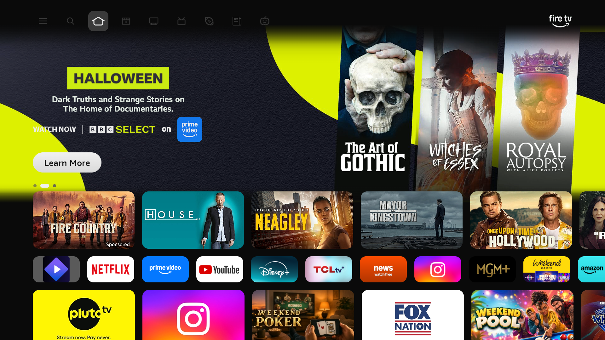
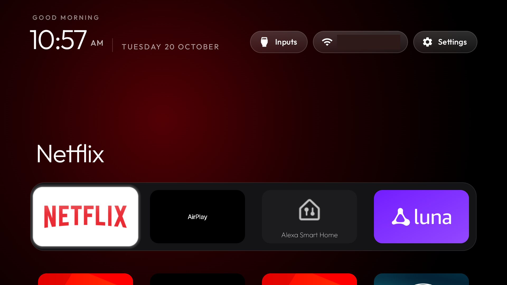
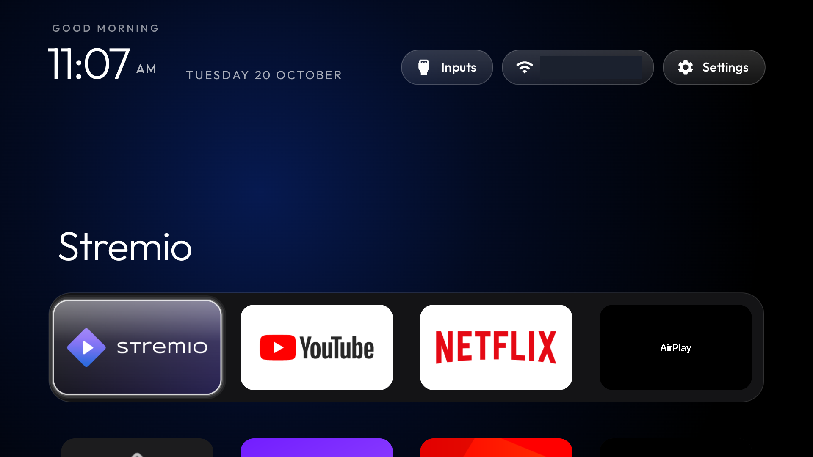

# Amazon Fire TV: remove the ads, and a clean home screen

Built on [cleanyourtv](https://github.com/Gathin23/cleanyourtv) by Gathin (MIT License, see [LICENSE](LICENSE)).
The original project and its README are kept in [docs/UPSTREAM-README.md](docs/UPSTREAM-README.md).

## Before and after

| Before: Amazon's home screen, with sponsored rows | After: the launcher over it, with a dock of your apps |
|---|---|
|  |  |

| Dock with Netflix in focus | Dock with Stremio in focus |
|---|---|
|  |  |

The Wi-Fi name in the top right was blanked out of the screenshots.
The "before" screenshot was taken after the first debloat batch, so the telemetry packages were already off.


This guide is for Amazon Fire TV (Fire OS) devices. It takes the ads, telemetry and preloads out of the
Fire TV, and puts a simple Apple TV-style launcher on top of Amazon's home screen, with your apps in a dock.

It's built from one tested device (Fire TV, model AFTDEC012E, codename ginza, Android 11, build
RS8185.3885N). Other Fire TV models may need different package names. Read [What works, and what doesn't](#what-works-and-what-doesnt)
before you start.

## What you get

- **Less telemetry, fewer ads.** Amazon's metrics, content recognition (ACR), shopping and tutorial packages
  are disabled. Nothing is uninstalled, and everything can be turned back on.
- **A simple home screen.** The launcher opens whenever you press Home, with a clock, a dock of the apps you
  pick, and a grid of the rest. Amazon's home screen with its sponsored rows is still installed, but you don't
  see it.
- **A clock screensaver** instead of Amazon's, which shows promotions.

## What you need

- A Fire TV on the same Wi-Fi as your computer.
- A computer with Mac or Linux. (Windows works only for the debloat step; see [Windows](#windows).)
- Java 17 and the Android SDK (platform 34, build-tools 34.0.0), to build the launcher.
  On a Mac with Homebrew:
  ```sh
  brew install openjdk@17
  brew install --cask android-commandlinetools
  # sdkmanager sits in the cask's folder, not on PATH:
  SDK=/opt/homebrew/share/android-commandlinetools
  $SDK/cmdline-tools/latest/bin/sdkmanager --licenses
  $SDK/cmdline-tools/latest/bin/sdkmanager "platforms;android-34" "build-tools;34.0.0"
  ```
- Python 3 (for the ADB client in `tools/`).

## 1. Turn on ADB on the Fire TV

1. On the Fire TV, go to **Settings → My Fire TV → About**, then select the device name seven times.
   You'll see "You are now a developer".
2. Go back to **Settings → My Fire TV → Developer Options**. Turn on **ADB Debugging**. If you see
   **Apps from Unknown Sources**, you can leave it off; the install uses ADB.
3. Go to **Settings → My Fire TV → About → Network** and write down the IP address (for example `192.168.1.50`).
4. Keep the TV on. The first time your computer connects, the TV asks **Allow ADB debugging?**. Choose
   **Always allow**.

## 2. Get the repo and check the connection

```sh
git clone https://github.com/GaneshVarma1/cleanyourtv-firetv.git
cd cleanyourtv-firetv
python3 -m venv tools/venv
tools/venv/bin/pip install -r tools/requirements.txt
```

Set your TV's IP once, and use it in every command below:

```sh
export TV_HOST=192.168.1.50      # your Fire TV's IP
tools/venv/bin/python -I tools/tv.py --probe
```

You should see `ro.product.brand = Amazon` and the Android version. If it hangs, accept the prompt on the TV
and run it again.

## 3. Remove the telemetry and ads (debloat)

Check the packages on your TV first, so you know what's there:

```sh
tools/venv/bin/python -I tools/tv.py 'pm list packages -u' | sort
```

If your model is AFTDEC012E, apply the tested list:

```sh
tools/disable.sh examples/amazon-fire-tv-aftdec012e/debloat.txt
```

The script disables each package with `pm disable-user`, and writes a record of the previous state under
`~/.cleanyourtv/`, so you can undo it. After each batch, press Home on the remote; your streaming apps should
still open. If your Fire TV is a different model, start from that list and remove the packages that aren't on
your TV. Packages that Fire OS protects are refused, and the script shows which ones.

The list leaves these on purpose: Alexa, OTA updates, casting to the TV (DIAL), Netflix, YouTube, Prime Video and
voice search. The Miracast receiver, MiniTV, Disney+ and Tubi are listed at the bottom, commented out; uncomment
the ones you don't use.

## 4. Choose your dock apps (optional)

The dock is the row of four big tiles at the bottom. It uses package names. Find yours with:

```sh
tools/venv/bin/python -I tools/tv.py 'pm list packages' | grep -i -E 'netflix|youtube|stremio|amazonvideo'
```

Edit `dock_apps` in `launcher/app/src/main/res/values/config.xml`, in the order you want:

```xml
<string-array name="dock_apps">
    <item>com.stremio.one</item>
    <item>com.amazon.firetv.youtube</item>
    <item>com.netflix.ninja</item>
    <item>com.amazon.amazonvideo.livingroom</item>
</string-array>
```

Apps that aren't installed are skipped, and the free slots are filled from the grid. Dock changes are part of
the next build (step 5).

## 5. Build and install the launcher

```sh
cd launcher
TV_HOST=$TV_HOST ./build-and-install.sh
cd ..
```

The script detects that Home belongs to Amazon's launcher and installs in **Fire mode**:

- Amazon's launcher stays enabled. Fire OS won't let another app take Home, and that can't be changed.
- The launcher is installed, and the `HomeKeyService` accessibility service is switched on. This service is
  what brings the launcher to the front.
- The launcher's clock replaces Amazon's screensaver.

You should see `Fire mode: Home stays with com.amazon.tv.launcher…` and `Installed. Press Home on the remote to
see it.` at the end.

## 6. Check it

Press **Home** on the remote. The launcher should come up with the clock, the dock and the grid.

Now check the Home button from an app:

1. Open Netflix from the dock.
2. Press Home on the remote.
3. The launcher should appear. You may see a brief flash of Amazon's home first.

If it doesn't, see [Troubleshooting](#troubleshooting).

## Undo

To go back to the stock Fire TV, from the repo folder:

```sh
# 1. Turn Amazon's packages back on from the record that was saved when you debloated:
TV_HOST=$TV_HOST tools/restore.sh examples/amazon-fire-tv-aftdec012e/debloat.txt com.amazon.tv.launcher

# 2. Stop the Home watcher and remove the launcher:
tools/venv/bin/python -I tools/tv.py 'settings delete secure enabled_accessibility_services'
tools/venv/bin/python -I tools/tv.py 'settings put secure accessibility_enabled 0'
tools/venv/bin/python -I tools/tv.py 'pm uninstall com.gathin.tvhome'

# 3. Put Amazon's screensaver back:
tools/venv/bin/python -I tools/tv.py 'settings put secure screensaver_components com.amazon.ftv.screensaver/.app.services.ScreensaverService'
```

Before step 5, record the current value with `settings get secure screensaver_components`, and use that value in
step 3. The value shown in step 3 is the one on the tested device.

## Turn off ADB when you're done

ADB on the TV gives full control of the device, and port 5555 is not encrypted. On some firmware it accepts any
device on the network. When you've finished:

1. On the TV, turn **ADB Debugging** off under **Settings → My Fire TV → Developer Options**.
2. Reboot the TV.
3. From your computer, check that the port is closed: `nc -vz $TV_HOST 5555` should fail.

Don't leave port 5555 open on your home network.

## What works, and what doesn't

**Works (tested):**
- Telemetry, ACR, shopping, tutorial and preload packages disabled; Home and the streaming apps still work.
- The launcher comes up when you press Home from an app, and Back from the launcher stays on it.
- The setup survives a reboot.

**Doesn't work, and why:**
- **The launcher can't be the Home app.** Amazon's launcher holds Home at a priority that other apps can't
  beat, and Fire OS refuses to disable it. The tests: a higher priority on our Home filter is ignored;
  `cmd package set-home-activity` reports Success but changes nothing; disabling Amazon's launcher or its
  home component is refused.
- **Intercepting the Home key directly doesn't work** on this device. The watcher described above is the
  workaround.

**Known limits:**
- A brief flash of Amazon's home shows before the launcher covers it.
- Amazon's home keeps running in the background. Fire OS refuses `am force-stop` for it.
- Sponsored rows aren't removed from Amazon's home screen; they're just covered.
- Amazon's screensaver is replaced with the launcher's clock, not removed from the TV.

## Troubleshooting

- **`tv.py --probe` hangs or says "unauthorized"**: Accept the **Allow ADB debugging?** prompt on the TV
  (choose Always allow), then run the command again. Make sure the IP is right and the TV is awake.
- **The launcher doesn't come up on Home**: check the watcher is on:
  `tools/venv/bin/python -I tools/tv.py 'settings get secure enabled_accessibility_services'` should list
  `com.gathin.tvhome/com.gathin.tvhome.HomeKeyService`. If it doesn't, run `build-and-install.sh` again.
- **The build fails on `sdk.dir` or Java**: set `ANDROID_HOME` to your SDK folder and `JAVA_HOME` to a
  Java 17 install, then run the build again.
- **A streaming app stopped working after debloat**: undo the list with `tools/restore.sh` (above), then
  comment out that package in `debloat.txt` and apply again.
- **Something else is wrong**: use `tools/restore.sh` to undo everything, then open an issue with your model
  (Settings → My Fire TV → About) and the output of `--probe`.

## Windows

The debloat step works from Git Bash or WSL, using the same `tools/disable.sh`. The launcher install script
(`build-and-install.sh`) is Mac and Linux only for now. The Windows script (`build-and-install.ps1`) doesn't
have Fire mode yet, so Windows users should skip step 5 until it does.

## Notes for other Fire TV models

- The debloat list is for AFTDEC012E. Other models (for example the Toshiba and Insignia Fire TVs in `examples/`)
  have different package names. The lists there are tested on their own devices and are a starting point.
- Fire mode is detected automatically from the Home app, so it applies to any Fire OS device whose Home is
  Amazon's launcher. The launcher itself is tested on one device.
- Other Fire OS versions might behave differently, especially the accessibility and launcher behaviour.
  If you try another model, please report what you found.
